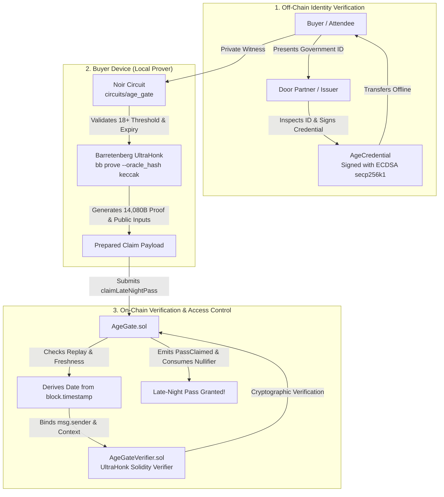

# zk-age-gate: Old Enough — and That's All You Get to Know

[](https://github.com/nikitabiradar231/zk-age-gate_D10_p3/actions/workflows/ci.yml)
[](https://opensource.org/licenses/MIT)
[](https://noir-lang.org/)
[](https://github.com/AztecProtocol/aztec-packages)
[](https://soliditylang.org/)

Zero-knowledge age-gated festival pass claiming for **Slow Bloom Festival 2026**.

**Challenge**: Road to Devcon X — Problem 3  
**Challenge Identifier**: `zk-gated-age-proof`  
**Repository**: `zk-age-gate`

---

## 1. Project Overview

**Slow Bloom** is an outdoor electronic music and arts festival. To attend the restricted Late-Night Stage (starting at 02:00 AM), festival attendees must prove they are at least **18 years old** on the date of entry.

Traditionally, attendees are forced to hand over passports or driver's licenses, revealing their exact birth date, full legal name, home address, and government identification numbers to door personnel or web forms.

**zk-age-gate** provides a production-grade cryptographic alternative:
- The festival door partner verifies physical ID once off-chain and issues a cryptographically authenticated credential signed using ECDSA secp256k1.
- The attendee generates a zero-knowledge UltraHonk SNARK proof on their local device.
- The smart contract verifies the proof on-chain and awards the late-night pass.
- **The attendee's birth date, birth month, birth year, and identity documents are NEVER disclosed to the festival, smart contract, or public blockchain observers.**

---

## 2. Architecture & Flow



---

## 3. Cryptographic Design

### 3.1 Trusted Birth-Date Attestation
A zero-knowledge proof of an arbitrary self-selected number is meaningless without an authentic attestation. The Slow Bloom door partner checks government credentials off-chain and signs a 56-byte credential payload:
$$\text{Payload} = \text{credential\_id}[32] \parallel \text{birth\_date}[4] \parallel \text{expiry\_date}[4] \parallel \text{buyer\_id\_commitment}[16]$$

The signature is verified inside the Noir circuit using `std::ecdsa_secp256k1::verify_signature`.

### 3.2 Private Witness
The following fields remain strictly local to the buyer's device and enter the circuit only as private witness inputs:
- `birth_year`, `birth_month`, `birth_day`
- `expiry_year`, `expiry_month`, `expiry_day`
- `credential_id` (32 bytes)
- `buyer_secret` (32 bytes private salt)
- `issuer_signature` (64 bytes raw signature)

### 3.3 Public Inputs
The circuit exposes exactly 9 public inputs:
1. `claimant`: Bound to `msg.sender` (prevents mempool front-running).
2. `festival_context`: `SLOW_BLOOM_FESTIVAL_2026` (domain separation).
3. `pass_type`: `1` (Late-Night Pass).
4. `ref_year`: UTC reference year derived from `block.timestamp`.
5. `ref_month`: UTC reference month derived from `block.timestamp`.
6. `ref_day`: UTC reference day derived from `block.timestamp`.
7. `claim_timestamp`: Proof generation timestamp (valid for 1 hour).
8. `issuer_pubkey_hash`: BN254 commitment to the door partner's public key.
9. `nullifier`: Deterministic replay protection commitment.

### 3.4 Accurate Civil Calendar & Leap-Year Semantics
The circuit strictly implements Gregorian calendar rules without approximation:
- Leap years: `(year % 4 == 0 && year % 100 != 0) || (year % 400 == 0)`.
- Leap-day babies (born February 29) legally complete their 18th year on March 1st in non-leap years.

---

## 4. Prerequisites & Versions

| Component | Required Version | Status |
| :--- | :--- | :--- |
| **Node.js** | `>= 22.0.0` (Tested on `v24.11.0` LTS) | Supported |
| **Foundry (`forge`)** | `>= 1.8.0` (Tested on `v1.8.1` / `v1.8.6`) | Supported |
| **Nargo (Noir)** | `v1.0.0-beta.3` | Supported |
| **Barretenberg (`bb`)** | `v0.82.2` (Patched UltraHonk release) | Supported |

---

## 5. Installation & Setup

```bash
# 1. Clone repository
git clone https://github.com/nikitabiradar231/zk-age-gate_D10_p3.git
cd zk-age-gate_D10_p3

# 2. Install Node dependencies
npm install

# 3. Setup environment configuration
cp .env.example .env
```

To install Nargo and Barretenberg if not already installed:
```bash
# Install Nargo
curl -L https://raw.githubusercontent.com/noir-lang/noirup/main/install | bash
noirup -v 1.0.0-beta.3

# Install Barretenberg
curl -L https://raw.githubusercontent.com/AztecProtocol/aztec-packages/master/barretenberg/bbup/install | bash
bbup -v 0.82.2
```

---

## 6. Build & Compilation

Compile the Noir circuit, generate the UltraHonk verification key, produce the Solidity verifier, and compile with Foundry:

```bash
npm run build
```

This runs `scripts/build-circuit.ts`:
1. Compiles `circuits/age_gate` with Nargo (`target/age_gate.json`).
2. Generates the UltraHonk verification key with Keccak random oracle (`target/vk/vk`).
3. Generates `contracts/generated/AgeGateVerifier.sol` via `bb write_solidity_verifier`.
4. Compiles Solidity contracts with Foundry `forge build`.

---

## 7. Running Tests

The test suite runs 50+ real cryptographic and contract tests:

```bash
# Run all tests (Circuits + TypeScript + Foundry Contracts)
npm test

# Run only Noir circuit unit and integration tests
npm run test:circuits

# Run only TypeScript client tests
npm run test:ts

# Run only Foundry smart contract tests
npm run test:contracts
```

---

## 8. End-to-End Prover Demonstration

Generate a real zero-knowledge proof locally:
```bash
npm run prove -- --claimant 0x70997970C51812dc3A010C7d01b50e0d17dc79C8 --birth-year 2004 --birth-month 3 --birth-day 15
```

Verify the proof with Barretenberg:
```bash
npm run verify -- --proof ./target/proof.json
```

Verify that no secrets exist in tracked files:
```bash
npm run check:no-secrets
```

Verify that generated artifacts are up-to-date:
```bash
npm run check:artifacts
```

---

## 9. Official Acceptance Criteria Verification

All 10 official criteria from the Road to Devcon X specification are fully satisfied:

| # | Criterion | Result | Evidence |
| :-: | :--- | :-: | :--- |
| 1 | Policy parameters fixed by contract | **PASS** | `AgeGate.sol` derives reference date from `block.timestamp` and enforces constants |
| 2 | Proof bound to claiming account | **PASS** | `AgeGate.sol` checks `publicInputs[0] == msg.sender`; `AgeGate.t.sol` tests theft rejection |
| 3 | Age comparison cryptographically enforced | **PASS** | Circuit asserts `ref_date >= 18th_birthday`; `age_gate.test.ts` asserts underage rejection |
| 4 | Proof cannot be accepted twice | **PASS** | Storage mapping `consumedNullifiers` rejects repeat claims |
| 5 | Stale proofs rejected | **PASS** | Contract enforces `block.timestamp - claim_timestamp <= 3600` |
| 6 | Proving occurs on buyer's device | **PASS** | `src/client/prove.ts` runs local witness generation and UltraHonk proving |
| 7 | Birth date is not a public input | **PASS** | Only 9 public inputs exist; birth date is purely private witness |
| 8 | Access granted only after verifier success | **PASS** | `AgeGate.sol` checks `verifier.verify() == true`; failing verifier grants no access |
| 9 | Test asserts underage witness fails | **PASS** | Circuit test `test_underage_candidate_fails` and TS test assert constraint violation |
| 10 | No secret appears in tracked files | **PASS** | `npm run check:no-secrets` scans 112 tracked files with 0 violations |

See [ACCEPTANCE_CRITERIA.md](docs/ACCEPTANCE_CRITERIA.md) for full mapping.

---

## 10. Security & Privacy Documentation

Detailed engineering analyses are available in `docs/`:
- [PRIVACY.md](docs/PRIVACY.md): Data classification, local isolation, and blockchain anonymity limits.
- [TRUST_ASSUMPTIONS.md](docs/TRUST_ASSUMPTIONS.md): Door partner identity checking, cryptographic assumptions, and key rotation.
- [THREAT_MODEL.md](docs/THREAT_MODEL.md): Attack vectors (front-running, replay attacks, forged credentials) and mitigations.
- [SECURITY.md](docs/SECURITY.md): Operational hardening, responsible disclosure, and production checklist.

---

## 11. Disclaimer & Production Notice

> [!CAUTION]
> This repository is developed as an educational and challenge submission for **Road to Devcon X**. While it uses production-grade cryptographic primitives, it has not undergone an independent professional security audit. Do not use test credentials or keys on public mainnet environments.
